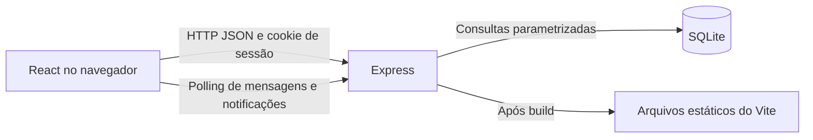
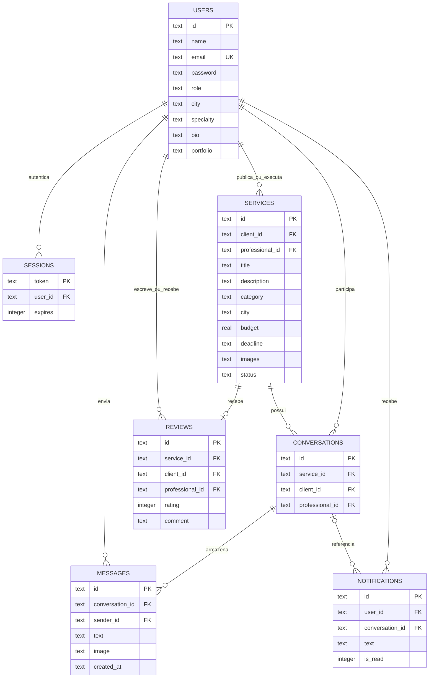
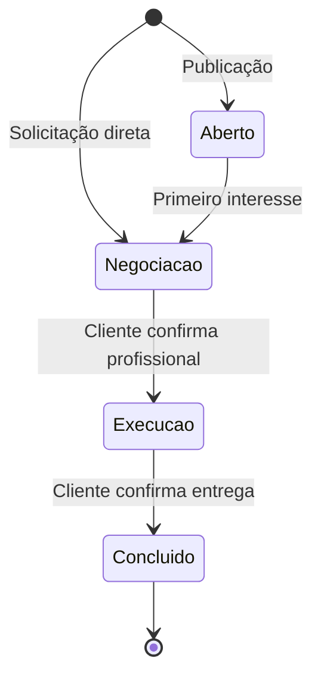

# Arquitetura e modelagem

## Decisões técnicas

O protótipo usa React 19 com Vite no frontend, Express 5 no backend e SQLite nativo do Node.js 24. A interface e a API podem ser servidas pelo mesmo processo após o build. Em desenvolvimento, Vite faz proxy de `/api` para a porta 4311. A origem do frontend de desenvolvimento é explicitamente autorizada; outras origens não são liberadas por CORS.

SQLite dispensa instalar um servidor de banco para uma demonstração acadêmica. O modelo relacional expressa vínculos entre clientes, serviços, profissionais e avaliações. Operações síncronas e imagens embutidas simplificam o protótipo, mas não são uma estratégia para grande volume de usuários.

React usa componentes reutilizáveis para campos, modais, status, avatares e upload. O estado de navegação fica no hash da URL. A busca é aplicada sobre os registros carregados, com normalização de acentos. Para crescimento, separar páginas em módulos, adotar paginação e mover os filtros para consultas no servidor são próximos passos.



## Modelo de dados



`professional_id` no serviço é nulo em anúncios abertos. Na solicitação direta identifica o destinatário antes da confirmação. O estado `active` diferencia uma contratação confirmada de uma solicitação. A combinação serviço/profissional é única em conversas. `service_id` é único em avaliações. Imagens e portfólio são arrays JSON de data URLs; mensagens têm uma imagem opcional.

## Casos de uso

| Ator | Casos de uso | Pré-condição |
| --- | --- | --- |
| Visitante | Consultar serviços e perfis; filtrar; cadastrar e entrar | Nenhuma |
| Cliente | Publicar anúncio; solicitar diretamente; conversar; contratar; concluir; avaliar | Sessão com papel cliente; propriedade do serviço |
| Profissional | Editar descrição e portfólio; localizar serviços; demonstrar interesse; conversar | Sessão profissional; participação no chat |
| Ambos | Editar perfil; consultar notificações; marcar leitura; sair | Sessão ativa |

## Sequência de contratação por anúncio

```mermaid
sequenceDiagram
  participant C as Cliente
  participant R as React
  participant A as API
  participant D as SQLite
  participant P as Profissional
  C->>R: Publica descrição, orçamento, prazo e fotos
  R->>A: POST /api/services
  A->>D: Salva serviço aberto
  P->>R: Localiza serviço e demonstra interesse
  R->>A: POST /api/services/:id/interest
  A->>D: Cria conversa e notificação; status negociação
  C->>R: Troca mensagens com profissional
  R->>A: POST /api/conversations/:id/messages
  A->>D: Persiste mensagem e notifica destinatário
  C->>R: Confirma profissional escolhido
  R->>A: PATCH /api/services/:id/status
  A->>D: Vincula profissional; status execução
  C->>R: Conclui e avalia
  R->>A: PATCH status; POST reviews
  A->>D: Conclui serviço e registra avaliação única
```

## Estados do serviço



## API

Todos os corpos são JSON. Erros retornam `{ "error": "mensagem em português" }`. Sessão é obtida por cookie `trena_session` e não por dados enviados no corpo.

| Método | Rota | Acesso e função |
| --- | --- | --- |
| GET | /api/health | Saúde do servidor |
| GET | /api/auth/me | Usuário atual ou null |
| POST | /api/auth/register | Cadastro; name, email, password, role, city, specialty, bio |
| POST | /api/auth/login | email e password; cria sessão |
| POST | /api/auth/logout | Encerra sessão |
| PATCH | /api/profile | Atualiza name, city, specialty, bio, portfolio do autenticado |
| GET | /api/professionals | Perfis públicos com média das avaliações |
| GET | /api/professionals/:id | Perfil, portfólio e comentários |
| GET | /api/services | Anúncios disponíveis |
| GET | /api/services?mine=1 | Serviços do usuário ou com negociação da qual participa |
| POST | /api/services | Cliente; title, description, category, city, budget, deadline, images e professional_id opcional |
| POST | /api/services/:id/interest | Profissional; cria ou recupera conversa |
| PATCH | /api/services/:id/status | Cliente proprietário; status e professional_id para contratação |
| GET | /api/conversations | Conversas do usuário |
| GET | /api/conversations/:id/messages | Somente participantes |
| POST | /api/conversations/:id/messages | Participante; text e image opcional |
| POST | /api/services/:id/reviews | Cliente proprietário; rating e comment |
| GET | /api/notifications | Últimas 100 notificações do usuário |
| PATCH | /api/notifications/read | Marca todas do usuário como lidas |

## Proteções e limites

Senhas usam scrypt com salt aleatório; sessões usam tokens de 32 bytes e só o SHA-256 é armazenado no banco. SQL usa parâmetros, sem interpolar dados do usuário. A API valida papéis, participantes, transições de estado, notas e imagens. Cookies são HTTP-only, SameSite Strict e Secure em produção. Cadastro/login têm limite por IP de 20 chamadas por minuto no processo atual.

O protótipo não inclui verificação de e-mail, recuperação de senha, moderação, antivírus de imagens, prevenção distribuída de abuso, backup automatizado ou processo completo de privacidade. A validação de assinatura de imagem é básica; em produção usar decodificação e reencodificação. Uso público exige revisão de segurança, HTTPS, limites de armazenamento, política de privacidade e retirada das contas fictícias. O modelo de notificações usa polling, sem garantia de entrega fora da aplicação aberta.

Datas de criação usam UTC. Valores monetários são estimativas em REAL do SQLite; um módulo financeiro futuro deve usar centavos inteiros e regras próprias. A busca por cidade é textual, não geográfica. Não se coleta documento de identidade nem se afirma verificação profissional.

## Referências técnicas

- [React](https://react.dev/)
- [Vite e requisitos de Node](https://vite.dev/guide/)
- [SQLite no Node.js 24](https://nodejs.org/download/release/latest-v24.x/docs/api/sqlite.html)
- [Express](https://expressjs.com/)
